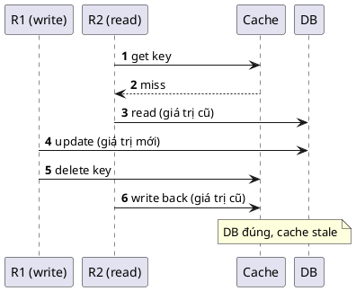

> Ghi chép từ buổi **Caching Design** trong khoá **Ronin Engineer S02**. Tôn trọng tác giả: nội
> dung thuộc về giảng viên, đây chỉ là bản ghi chép lại để ôn.

## 1. Cache là gì và hai trade-off

Cache là phần mềm hoặc phần cứng lưu **dữ liệu tạm thời** để phục vụ request sau nhanh hơn. Dữ
liệu trong cache thuộc một trong hai loại:

1. Bản **copy** của dữ liệu nguồn.
2. **Kết quả tính toán trước** (tổng hợp, đếm, danh sách).

Với backend, cache là **lá chắn cho database**: hứng traffic đọc để DB không quá tải.

| Trade-off | Nội dung |
|---|---|
| Performance ↔ Cost | Cache nằm trên memory, memory có hạn và đắt. Cache nhiều = nhanh hơn = tốn hơn |
| Performance ↔ Consistency | Dữ liệu cache có thể sai lệch so với DB. **Đây là trọng tâm của cả bài** |

## 2. Cache nằm ở đâu trong hệ thống web

| Tầng | Phù hợp cache gì |
|---|---|
| CDN | Static / media file (image, video, audio), phân tán data center toàn cầu |
| Proxy | HTML, CSS, file web tĩnh |
| Client | API response, dữ liệu ít thay đổi |
| Database | Kết quả query trước đó |
| Remote cache (Redis) | Kết quả tính toán trước, dữ liệu **chia sẻ giữa các instance** |
| Local cache (memory của app) | Config, dữ liệu nhỏ (ví dụ danh sách sân bay). Memory server còn phải dùng cho nhiều việc khác |

Đừng hỏi "lưu dữ liệu thế nào" trước. Hỏi **data access pattern** trước: cách bạn thao tác với dữ
liệu quyết định cách tổ chức dữ liệu và chọn database.

## 3. Read strategy

Hai loại: **read-through** và **read-aside**. Bài tập trung read-aside vì phổ biến hơn.

**Read-aside**: đọc cache → *hit* thì trả về; *miss* thì đọc DB → **ghi lại vào cache** cho lần sau.

| Ưu | Nhược |
|---|---|
| **Chống chịu lỗi**: cache chết, app vẫn chạy qua DB | Data inconsistency |
| **Linh hoạt**: model cache khác model DB (DB 10 trường, cache chỉ 3) | App thao tác 2 hệ thống → logic phức tạp hơn read-through |

## 4. Write strategy

Ba loại: **write-through**, **write-back**, **write-around**. Bài tập trung write-around.

**Write-around**:

1. Ghi vào DB, **synchronous**.
2. **Invalidate** cache, **asynchronous**, có thể trước hoặc sau bước 1.

`invalidate` là **delete** hoặc **update / replace** key trong cache.

| Ưu | Nhược |
|---|---|
| Cache và DB không phụ thuộc nhau. Cache chết, luồng ghi vẫn chạy | Data inconsistency |
| | Kém hiệu quả với hệ thống **write-heavy**: invalidate liên tục thì cache gần như vô dụng |

Keyword để đọc thêm: **dual write**, vấn đề chung khi ghi vào 2 hệ thống tách biệt.

## 5. Phân nhóm cache invalidation

| Theo | Cách làm |
|---|---|
| **Time-based** | Set TTL cho key |
| **Command-based** | Chủ động invalidate sau khi ghi DB (write-around) |
| **Event-based** | Bị động: nghe binlog stream / CDC rồi update cache |
| **Group-based** | Theo nhóm key |

## 6. Tại sao cache invalidation khó

> Trong computer science có hai thứ khó: naming things và cache invalidation.

Khó vì là **tổ hợp** của nhiều yếu tố cùng lúc:

- **Timing**: TTL bao nhiêu là hợp lý? User profile phải ngắn hơn danh sách sân bay, nhưng ngắn
  hơn *bao nhiêu*?
- **Concurrency**: race condition gây inconsistency (mục 7).
- **Quan hệ dữ liệu**: invalidate một key có thể phải kéo theo các key liên quan. Làm sao biết
  key nào liên quan?
- **Tính phân tán**: xem dưới.

Khác biệt cơ bản, và là gốc của cái khó:

> **Cache ở mọi nơi** (client, proxy, CDN, remote, local). **Database thì tập trung** về mặt logic.

Client là chỗ khó control nhất: on/off bất cứ lúc nào, DB update rồi thì làm sao invalidate cache
phía client? Và khi lỗi, cache ở khắp nơi nên rất khó tìm root cause.

## 7. Race condition: phân tích bốn trường hợp

Đây là phần lõi của bài. Kết hợp **write-around + read-aside**, invalidate có thể *update* hoặc
*delete*, làm *trước* hoặc *sau* khi ghi DB → 4 trường hợp. Hai request ghi R1 (x=1) và R2 (x=2)
chạy đồng thời.

### Dùng update cache

| Thứ tự | Kịch bản | Kết quả |
|---|---|---|
| Update cache **trước** | R1 update cache x=1 → R2 update cache x=2 → R2 update DB x=2 → R1 update DB x=1 | **DB sai** (tệ nhất) |
| Update cache **sau** | R1 update DB → R2 update DB → R2 update cache → R1 update cache | DB đúng, **cache sai** |

Update kiểu nào cũng còn inconsistency, và có trường hợp làm sai cả DB. Loại bỏ `update`.

### Dùng delete cache

Hai request ghi thì không vấn đề: cache rỗng, lần đọc sau xuống DB lấy giá trị đúng. Vấn đề xuất
hiện khi **kết hợp với read-aside**: một request ghi R1 và một request đọc R2.

**Delete cache trước:**

**Delete cache sau:**

### Kết luận: update DB trước, delete cache sau

Không phải vì nó đúng tuyệt đối, cả hai đều còn khả năng sai. Mà vì **tỷ lệ xảy ra thấp hơn**:

- Để lỗi xảy ra ở "delete sau", cặp `update DB → delete cache` của R1 phải **xen vào giữa** cặp
  `read DB → write back cache` của R2.
- Ghi vào cache **rất nhanh**, nên khoảng cách giữa `read DB` và `write back cache` rất hẹp,
  rất khó xen vào.
- Ngược lại ở "delete trước", cửa sổ giữa `delete cache` và `update DB` của R1 là một thao tác
  update DB **chậm**, cửa sổ rộng, R2 dễ xen vào hơn.

Combo phổ biến trong thực tế: **read-aside + write-around + delete-after**.

Giảm thiểu ảnh hưởng khi inconsistency vẫn xảy ra: **TTL ngắn**. Đây là *hạn chế*, không phải
*giải quyết*.

## 8. Challenge về độ tin cậy

### Invalidate cache fail

DB ghi thành công nhưng xoá cache thất bại → dữ liệu cũ tồn tại. **Retry** trước. Sau đó dùng
**CDC** nghe binlog stream để update cache.

### Cache down

Traffic dồn hết vào DB → DB cũng chết. Nghĩ theo **ba thời điểm**:

| Thời điểm | Giải pháp |
|---|---|
| **Trước** sự cố | HA: dựng cụm Redis, instance chết thì con khác lên master |
| **Trong** sự cố | **Rate limit** hoặc **circuit breaker**, và chỉ áp cho **luồng có traffic lớn**. Các luồng khác (thanh toán, hỏi đáp) vẫn phải chạy |
| **Sau** sự cố | Recover nhanh và recover **đúng** dữ liệu |

### Cache avalanche

Cache không chết, nhưng **rất nhiều key hết hạn cùng lúc** → traffic dồn vào DB.

→ **Random TTL.** Chỉ cần thế là đủ: expiry time dàn đều ra, mỗi thời điểm chỉ một tập nhỏ key
hết hạn.

### Cache breakdown

Một **hotkey** hết hạn, traffic lớn dồn vào DB.

- TTL lớn, hoặc **không set expiry** cộng job định kỳ đẩy dữ liệu mới vào cache.
- **Lock / mutex**: chỉ một request được đọc DB và cập nhật cache, các request khác đợi. Phức
  tạp, không phù hợp mọi trường hợp.

*Làm sao biết key nào là hotkey?* Đếm request/key theo ngưỡng thì phức tạp, thường làm ở tầng
proxy. Đơn giản hơn: **cấu hình sẵn** hotkey theo business logic.

### Cache penetration

Dữ liệu **không có ở cache và cũng không có ở DB** → mọi request đều xuống DB và không bao giờ
write back được.

- Set **default value (ví dụ null) trong cache**, không phải trong DB.
- **Validate input**: mã sân bay chỉ 3 ký tự, đầu vào 5 ký tự thì chặn ngay.
- **Bloom filter** (nâng cao, đọc thêm).

## 9. Challenge về high traffic

### Hotkey trong cluster

Cụm có nhiều node cache, node 1 chứa 2 hotkey → traffic dồn vào node 1 rất lớn, node 2 và 3 tải
rất nhỏ. Điểm cần nhớ: **số lượng key đã chia đều rồi**, cái lệch là *traffic*, không phải số
key, nên load balancer thông thường không giải quyết được. Rủi ro không chỉ là chậm: tải lớn dồn
vào một node **có thể làm node đó go down**.

| Giải pháp | Đánh đổi |
|---|---|
| **Replicate** hotkey sang node khác | Phải tự implement logic load balancer giữa các node |
| Thêm tầng **proxy** (giải pháp enterprise): LB cộng đếm hotkey tại proxy | Dùng thì đơn giản, **triển khai** mới phức tạp |
| **Local cache hotkey ở tầng app** | Memory app throughput rất lớn → hiệu quả, đơn giản. Đổi lại tốn effort đồng bộ và phải invalidate cả local cache |

Local cache nên build **trực tiếp từ database**, không phải từ cache server, tránh cache-của-cache.

Câu hỏi để mở, chưa được trả lời trong buổi: đặt hotkey trên 2 node để tránh node 1 go down,
nhưng trong mô hình **master-slave** có phải chỉ đọc ở master? Nếu vậy thì nằm trên 2 node không
chia được tải đọc. Xem thêm phần đọc master / đọc slave trong trang [Redis](/documents/caching/redis).

### Large key

Value lớn, không phải key lớn. Redis đơn luồng, request đến trước xử lý trước. Một key value lớn
xử lý lâu sẽ **dồn toa**, các key khác timeout.

Thứ tự ưu tiên giải pháp:

1. **Nén trước**: giải quyết được kích cỡ, logic đơn giản (1 to → 1 nhỏ).
2. **Chia nhỏ sau**: 1 to → nhiều nhỏ, phải xử lý nhiều phần, logic phức tạp hơn.
3. TTL lớn cho key lớn, tránh invalidate / refresh liên tục.
4. Nếu thực sự rất lớn: **đừng để trong cache**, dùng object storage (S3).

### Eviction khi gần hết memory

| Cơ chế | Giữ lại |
|---|---|
| **LRU** (least recently used) | Key được truy cập **gần đây** |
| **LFU** (least frequently used) | Key được truy cập **thường xuyên** |

"Gần đây" khác "thường xuyên". Redis cung cấp sẵn, chỉ cần cấu hình, có thể kết hợp cả hai.

## 10. Tổng kết

1. Nói đến dữ liệu thì đánh giá **data access pattern** trước.
2. **Read-aside + write-around + delete cache sau** là combo phổ biến. Vẫn có thể inconsistency
   nhưng tỷ lệ thấp nhất.
3. **TTL ngắn** để giảm ảnh hưởng khi inconsistency xảy ra.
4. **Key nhỏ**. Key lớn ảnh hưởng việc xử lý các key khác, để ở storage khác.
5. **Hotkey** → job định kỳ làm mới dữ liệu trong cache.
6. Cache invalidation khó vì tổ hợp **timing + concurrency + quan hệ dữ liệu + tính phân tán**.
7. Khác biệt cơ bản: **cache ở mọi nơi, database thì tập trung**.

## Thử làm

1. Đọc từ Redis ra danh sách airport, `key` là mã sân bay, `value` là tên sân bay. Viết app lấy
   ra danh sách đó.
2. Implement **read-aside** với TTL, kèm database. Không bắt buộc có DB, dùng Redis là đủ. Được
   dùng thư viện.
