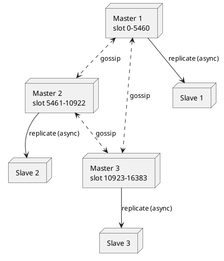

> Ghi chép từ buổi **Redis** trong khoá **Ronin Engineer S02**. Tôn trọng tác giả: nội dung thuộc
> về giảng viên, đây chỉ là bản ghi chép lại để ôn.

## 1. Redis là gì

**In-memory database, open source.** Nổi tiếng vì cung cấp **rất nhiều cấu trúc dữ liệu và tính
năng**: transaction, persistence, Lua script, cluster, Pub/Sub, stream, memory eviction. Cộng
đồng mạnh nên triển khai dễ, gặp lỗi dễ tìm hỗ trợ.

Use case: cache, key-value database, message queue / message broker.

### Redis vs Memcache

| | Redis | Memcache |
|---|---|---|
| Giống | In-memory, dùng làm cache, có TTL, performance tốt | |
| **Đọc** | **Tốt hơn** | |
| **Ghi** | | **Tốt hơn** |
| Cấu trúc dữ liệu | **Nhiều** | Ít |
| Persistence | Có | Không |
| Cluster mode | Có | Không |
| Tính năng khác | JSON, Pub/Sub, Lua… | Nghèo |

Use case chỉ là **cache đơn giản** thì Memcache đủ, triển khai đơn giản và rẻ hơn. Redis phổ biến
vì hôm nay chưa dùng cấu trúc này nhưng sau có thể dùng để giải bài toán mới, không phải đi tìm
giải pháp khác.

## 2. Ba kiến trúc triển khai

### Master-Slave

Ghi vào **master**, rồi **replicate sang slave**. Replicate là **asynchronous**: master gửi yêu
cầu rồi **không đợi** slave trả lời, có retry nếu lỗi nhưng vẫn async.

| Ưu | Nhược |
|---|---|
| **Mở rộng đọc**: ghi master, đọc slave, san tải cho master | **Data inconsistency** giữa master và slave |
| | **Không có failover**: master down thì không xác định được slave nào lên master, có thể phải recover bằng tay |

### Sentinel

Sinh ra để giải quyết failover. Một hoặc nhiều node **Sentinel** ("lính gác"):

1. **Monitor** master và các slave.
2. Master down → **bầu** một slave lên master mới.
3. **Thông báo** cho các slave còn lại follow master mới.

| Ưu | Nhược |
|---|---|
| Giải quyết **failover**, đơn giản | Vẫn **inconsistency** (bản chất vẫn master-slave, replicate async) |
| | **Tốn tài nguyên và công vận hành** cho các Sentinel, số Sentinel nên là **số lẻ** |
| | Vẫn **một master duy nhất** → tải ghi không được san sẻ |

### Cluster

Nhiều master, mỗi master có slave tương ứng. **Ghi trên nhiều master**, đọc trên slave.



| Ưu | Nhược |
|---|---|
| **Failover**: node nói chuyện qua giao thức **Gossip**, node down thì các node khác biết và bầu master mới | Vẫn **inconsistency** (replicate async) |
| **Mở rộng cả đọc và ghi**: traffic ghi san đều các master | **Nhiều node → tốn công vận hành** |

**Recommend dùng Cluster.**

## 3. Cluster hoạt động thế nào: hash slot

Một cụm có **16.384 hash slot**, chia **xấp xỉ đều** cho các master. Ví dụ 3 master: 0–5460,
5461–10922, 10923–16383.

```
slot = CRC16(key) mod 16384
```

Key rơi vào slot nào thì nằm ở master giữ slot đó. **Một slot chứa nhiều key**, hai key khác nhau
có thể cùng slot.

Hash slot ảnh hưởng đến nhiều tính năng: các function trên set (`SINTER`…) và transaction chỉ
chạy trên **cùng một slot**. Xem practice hashtag ở mục 9.

## 4. Data inconsistency và định lý CAP

Không kiến trúc nào của Redis giải quyết được inconsistency, vì replicate luôn async.

**Định lý CAP**: chỉ chọn được **2 trong 3** tính chất Consistency, Availability, Partition
tolerance. Failover là câu chuyện của availability. Chọn consistency thì hạn chế tính sẵn sàng,
không giải được high availability. Trong nhiều trường hợp tính sẵn sàng quan trọng hơn → đa số
**ưu tiên availability**.

**Workaround khi cần consistency cao**: inconsistency nằm giữa master và slave, vậy trường hợp
cần consistency thì **cả đọc cả ghi đều vào master**. 10 trường hợp chỉ 1 cần consistency cao →
implement riêng trường hợp đó đọc master, 9 trường hợp còn lại đọc slave.

Không riêng Redis, **database cũng vậy**. Giảng viên đã gặp thực tế đọc slave bị inconsistent,
phải chuyển cả đọc cả ghi về master.

## 5. Tại sao Redis nhanh

### Bottleneck nằm ở đâu

Nghĩ đến **tài nguyên** trước (memory, CPU, đĩa, network). HA chỉ tăng ngưỡng chịu đựng; giả sử
không mở rộng được nữa, tài nguyên nào chạm limit đầu tiên là bottleneck.

| Bottleneck | Lý do |
|---|---|
| **Memory** | Tài nguyên xa xỉ, phần cứng, khó mở rộng |
| **Network bandwidth** | Cache hứng traffic rất lớn cho database |

**Không phải CPU.** Database tính toán phức tạp (JOIN, scan, tổng hợp) nên CPU là bottleneck.
Redis thao tác đơn giản trên một dữ liệu cụ thể, không tốn CPU. Đây là lý do single thread có ý nghĩa.

### Bốn yếu tố

| Yếu tố | Ý |
|---|---|
| **In-memory** | Truy cập memory nhanh và rẻ hơn ổ đĩa |
| **Single thread** | Request xếp hàng, mỗi thời điểm một thao tác. Tránh chi phí switch thread và toàn bộ cơ chế lock / đồng bộ → logic đơn giản, ít bug. **Multi-thread không phải lúc nào cũng nhanh hơn**: locking và logic phức tạp có thể kéo performance xuống |
| **I/O multiplexing** | Bình thường mỗi request một thread, mỗi thread chiếm stack riêng. Multiplexing để **một thread xử lý nhiều request I/O** |
| **Cấu trúc dữ liệu tối ưu sẵn** | Dùng đúng cấu trúc là được hưởng |

### Tận dụng nhiều core

Single thread chỉ chạy một core. Giải pháp: **chạy nhiều instance Redis trên một máy**.

Từ **Redis 6.0** không còn thuần single thread: đọc / ghi vẫn trên **main thread**, nhưng
**persistence** và **network I/O** đẩy ra thread khác. Nên dùng version mới.

## 6. Redis lưu trữ và expire thế nào

### Global hash table

Hash key → vị trí trong hash table → **entry** gồm key pointer và value pointer. Key trỏ đến
string, value trỏ đến cấu trúc dữ liệu (string, list, hash, sorted set…). Lấy dữ liệu tổng thể **O(1)**.

### Hai dictionary

| Dictionary | Chứa |
|---|---|
| **Key dictionary** | key → value |
| **Expire dictionary** | key → expire time (long) |

Đọc một key: check expire dictionary trước (O(1)). Chưa hết hạn → đọc key dictionary. Hết hạn →
**trả null**, rồi xoá khỏi key dictionary.

### Passive delete

Xoá **sau khi đọc** phát hiện hết hạn. Vấn đề: key **không bao giờ được đọc** thì không bao giờ
bị check → tồn tại mãi, **waste memory**.

### Active delete

Job chạy **10 lần / giây**:

1. **Random 20 key** trong expire dictionary.
2. Xoá các key đã hết hạn.
3. Nếu **> 25%** trong 20 key đó hết hạn → quay lại bước 1. Không thì dừng, đợi lần sau.

Job chạy trên **main thread**, chạy lâu sẽ ảnh hưởng request khác. Redis có timeout cho job này;
thực tế không cần cấu hình, chỉ cần hiểu để biết điểm lưu ý. Redis kết hợp cả hai cơ chế. Version
mới tối ưu active delete bằng cách lưu expire time **đã sort**.

### Persistence

Redis down rồi restart là mất dữ liệu trên memory. Hai cơ chế đẩy xuống đĩa: **AOF** (Append
Only File) và **RDB** (Redis Database), có thể kết hợp. Phần này tự đọc thêm.

## 7. Chọn cấu trúc dữ liệu

Cấu trúc cơ bản: **string, list, hash, set, sorted set**. Redis đã implement sẵn, vấn đề của mình
là **dùng cấu trúc nào trong trường hợp nào**.

### Bài toán: lưu user object

Object `user {user_id, username, email, age}`. Access pattern: có lúc chỉ lấy `username`, có lúc
chỉ update `age`, có lúc lấy toàn bộ.

| | Hash | String JSON |
|---|---|---|
| Cách làm | Key gốc → hash table con (field → value) | Parse object ra JSON, lưu string |
| Update 1 field | Trực tiếp: `HSET key field value` | Đọc → parse → sửa → serialize → ghi |
| Lấy toàn bộ | `HGETALL` rồi format lại thành object | Đọc và parse một lần |
| Phù hợp khi | **Thường xuyên thao tác một số field** | Thao tác trên toàn bộ object |

Nguyên tắc: access pattern thao tác từng field → **hash**.

### Hash

Ba thành phần: **key 1** (key gốc, quyết định node nào), **key 2** (field), **value**. Ví dụ
**shopping cart**: key 1 = `user_id`, key 2 = `product_id`, value = số lượng.

| Thao tác | Lệnh |
|---|---|
| Tăng số lượng | `HINCRBY` |
| Đếm số sản phẩm | `HLEN` |
| Xoá sản phẩm | `HDEL` |
| Lấy một sản phẩm | `HGET` |
| Lấy cả giỏ | `HGETALL` |

### String

Implement bằng **SDS** (Simple Dynamic String), tối ưu cho cả text và binary, an toàn khi concat.
Dùng cho object nguyên khối, **biến đếm**, session, dữ liệu chia sẻ. **HyperLogLog** (đếm distinct
xấp xỉ) là tính năng đáng chú ý.

### Set

Có các **function trên tập** (giao, hiệu…). Lưu ý: function phải **tính toán**, tập lớn → tính
lâu → **chặn main thread**. Hạn chế intersect / diff trên tập lớn.

### Sorted set

Tập các phần tử **duy nhất, đã sắp xếp** theo score. Implement bằng **skip list**: nhiều tầng,
tầng trên thưa hơn. Tìm một phần tử **O(log n)**; tầng đáy đã sort và nối liền nên tìm được một
phần tử rồi **duyệt range rất nhanh**.

Ứng dụng: **rate limit**, sorting, **leaderboard**, **delay queue**. Nên tận dụng nhiều.

### List

Dùng làm queue.

## 8. Practice 1: Delay queue

**Bài toán**: order taxi, nếu **10 phút** không tài xế nào nhận → tự cancel và nhắc người dùng.
Làm sao biết thời điểm order hết hạn?

**Ý tưởng sai: set TTL rồi check key.** Lúc check thì key có thể **đã expire và bị xoá**, không
còn dữ liệu để xử lý. TTL để xoá dữ liệu, không phải để trigger logic.

**Giải pháp: sorted set**

- Member = order ID, **score = timestamp hết hạn**. Tập tự sort theo thời gian hết hạn.
- **Polling định kỳ**: tại thời điểm `now`, lấy các order có `score < now`. Vì đã sort, tìm vị
  trí của `now` rồi lấy toàn bộ phía trước, hiệu quả.
- Xử lý các order đó: cancel, nhắc.
- Chu kỳ polling (nửa giây, một giây) tuỳ yêu cầu hệ thống.

## 9. Practice 2: Big key

**Thế nào là lớn**: string value **> 10 KB**; list / set / hash / sorted set **> 5.000 phần tử**.

**Tác hại**: xử lý lâu, chiếm băng thông, xoá lâu, dữ liệu **lệch giữa các node**.

**Giải pháp**:

1. Không cần tập thì lưu từng phần tử dạng **string** rời.
2. Vẫn cần tập → **chia thành các tập con**.
3. Tìm big key bằng `SCAN`, các lệnh đếm length, `MEMORY USAGE`.
4. Xoá bằng **`UNLINK`**: chỉ xoá **pointer** trong key dictionary ngay (thao tác đọc không thấy
   nữa), dữ liệu thật được xoá **bất đồng bộ**. Hiệu quả hơn `DEL`.

## 10. Practice 3: Hashtag

**Vấn đề**: `followers:34` và `friends:34` của user 34, muốn `SINTER`. Hash 2 key có thể rơi vào
2 slot trên **2 master khác nhau** → Redis **không hỗ trợ** function giữa các set khác slot.

**Giải pháp: hashtag.** Dùng **ngoặc nhọn** để chỉ phần key đem đi hash: `followers:{34}`,
`friends:{34}`. Chỉ `34` được hash → cùng slot → chạy được.

**Transaction cũng vậy**: chỉ thực hiện trên **một hash slot**, không transaction xuyên các master.

## 11. Practice 4: Distributed lock

**Bài toán**: 2 instance backend nhận **2 request đồng thời**. Inventory còn 1, xử lý order là
trừ 1. Xử lý đồng thời cả 2 → inventory **= −1**. Yêu cầu: mỗi thời điểm **chỉ 1 request** được
xử lý và cập nhật DB. Đây là **race condition**.

**Giải pháp: `SET NX EX`**

```
SET lock_key 1 NX EX 20   -- acquire: chỉ set nếu key chưa tồn tại, có expire
... xử lý order ...
DEL lock_key              -- release
```

- `NX` (not exists): chỉ set khi key **chưa tồn tại**. Request thứ hai nhận **null** → không
  acquire được.
- **Phải có expire** để tránh **deadlock** khi instance giữ lock chết mà không release.
- Xử lý xong **phải nhả lock**.
- **Chỉ cần key giống nhau**, value tuỳ ý.

Demo với 2 session: dùng `SET` thường thì cả 2 đều sửa được key. Dùng `SET l1 1 NX EX 20`:
session 1 OK, session 2 trả null. Session 1 `DEL l1` → session 2 mới acquire được. Có lúc session
2 set được dù session 1 chưa release là do **hết 20 giây timeout**, key tự xoá.

Distributed lock là tính năng **rất quan trọng**, dùng rất nhiều, giải quyết bài toán điển hình
của backend.

## 12. Best practices

1. Dùng **Redis Cluster**: failover, mở rộng đọc và ghi. Đổi lại tốn công vận hành.
2. **Một lệnh cho nhiều key** (`MGET` / `MSET`) thay vì nhiều lệnh, dùng **pipeline** → giảm
   round-trip, tiết kiệm băng thông (một trong hai bottleneck).
3. **Tránh tác vụ chạy lâu**: tính toán giữa các tập. Hạn chế **big key**.
4. **TTL ngắn** trong hầu hết trường hợp; **random TTL** để tránh cache avalanche.
5. **Chọn đúng cấu trúc dữ liệu** cho use case.
6. Nhớ **hashtag** khi cần function trên set hoặc transaction xuyên key.
7. Tính năng nâng cao (search, JSON, vector search, stream) nằm ở **Redis Stack**, dự án xây
   trên Redis. Chọn Redis nào thì xem có cấu trúc mình cần không.

## 13. Q&A đáng nhớ

- **Message queue**: Redis có **Pub/Sub** sẵn. Queue dùng cấu trúc **list**. Stream có **Redis
  Streams**, không chắc đã vào core hay còn ở Stack, đọc doc.
- **Isolation**: Redis **không có** cơ chế isolation đầy đủ (read committed…) như database.
  Nhưng có **`WATCH`**: chỉ thực hiện transaction nếu key đang watch **không bị ai sửa** trong
  lúc đó. Isolation chỉ là tính năng; vấn đề là **bài toán muốn giải là gì**.
- **Tại sao Memcache ghi tốt hơn**: giảng viên chưa tìm hiểu, tham khảo trên mạng.

## Tổng kết

1. Cụm Redis có **16.384 hash slot** trải đều trên các master; một slot chứa **nhiều key**.
2. Bottleneck là **memory và network bandwidth**, **không phải CPU** → single thread có ý nghĩa.
3. Tận dụng **cấu trúc dữ liệu**. Nhiều tính năng nằm ở Redis Stack.
4. **Distributed lock** là tính năng quan trọng, phải hiểu rõ.

## Thử làm

Implement **distributed lock bằng Redis** cho bài toán 2 request đồng thời đặt **cùng một ghế**
trên một chuyến bay. Đảm bảo mỗi thời điểm chỉ 1 booking cho 1 ghế đi qua. Không cần implement
logic booking hay database phía sau, chỉ cần lớp lock.
