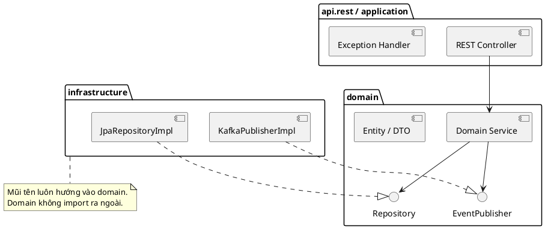

> Ghi chép từ buổi **Codebase Structure** trong khoá **Ronin Engineer S02**. Tôn trọng tác giả:
> nội dung thuộc về giảng viên, đây chỉ là bản ghi chép lại để ôn.

Câu hỏi mở đầu: đã bao giờ hỏi **tại sao** project lại structure thế này, tại sao có service và
repository? Khi dự án lớn lên, code khó quản lý, nhảy vào maintain rất khó tìm chỗ cần sửa. Ở mức
cao hơn: một domain thuộc team nào, ai là người chịu trách nhiệm? Lý thuyết kiến trúc thì đọc
nhiều, **áp dụng vào thực tế thế nào** mới là câu hỏi ai cũng gặp.

## 1. Năm architecture pattern

Dữ liệu luôn đi theo một luồng: người dùng tương tác → vào ứng dụng → giao tiếp hạ tầng (database,
messaging) → vòng lại ứng dụng → trả cho người dùng.

### Layered

Chia ứng dụng thành các **tầng theo chiều ngang**, thường là bốn: **presentation → business →
persistence → database**. Số tầng không cố định.

- Các tầng có tính **closed**: request phải đi **lần lượt qua từng tầng**, không nhảy cóc.
- **Shared service layer**: nhiều thành phần trong business layer dùng chung logic thì tách phần
  chung xuống một service layer bên dưới. Tầng này **open**, request có thể không đi qua.

| Ưu | Nhược |
|---|---|
| Đơn giản, dễ hiểu, dễ triển khai | Logic nhiều domain (payment, order, shipping) thì **khó mở rộng**: pattern chỉ chia **ngang**, không chỉ cách chia **dọc** |
| Test được từng layer | Không độc lập hoàn toàn, **chiều phụ thuộc từ trên xuống** |

### Hexagonal

Tách biệt các thành phần bên ngoài khỏi lõi ứng dụng bằng **port** và **adapter**.

- **Port là interface, adapter là implementation** cắm vào port. Port như **ổ cắm**, adapter như
  **phích cắm**, cắm phích nào cũng được.
- Phía vào: backend define API là port, frontend implement logic gọi API là adapter.
- Phía ra: port `saveFile` chỉ khai báo method; adapter có thể lưu **database**, **file system**
  hay **S3**.

| Ưu | Nhược |
|---|---|
| Ứng dụng **không phụ thuộc** thành phần ngoài | Người mới không biết **khi nào tạo interface** |
| **Dễ test**: mock adapter, không cần database hay S3 thật | |
| Dễ **đổi implementation** | |

Practice trả lời câu hỏi khi nào tạo interface: **khi giao tiếp với hệ thống bên ngoài**, tức
database, file system, S3, message broker.

### Onion

Cải tiến từ hai kiểu trên, giải quyết sự phụ thuộc giữa các layer và phụ thuộc vào hạ tầng.

Layered coi **database là trung tâm**. Onion coi **business domain là trung tâm**, các layer bọc
quanh, **chiều phụ thuộc hướng tâm** từ ngoài vào trong.

Dùng principle **Dependency Inversion**: layer trong không biết implementation của layer ngoài.
Domain **không import** bất cứ gì của application; application import class của domain. Khi layer
và chiều phụ thuộc đã rõ thì sửa logic domain không ảnh hưởng bên ngoài.

Ví như **củ hành**: lớp trong mà dính lớp ngoài thì rất khó bóc. Ngoài ôm vào trong, trong không
dính ra ngoài, thì bóc tách dễ.

| Ưu | Nhược |
|---|---|
| Tập trung vào domain, không lấy database làm trung tâm | Hơi phức tạp, mới tiếp cận mất công hiểu |
| Giảm phụ thuộc giữa layer và với hạ tầng, **dễ test** | |

### Clean Architecture

Thuật ngữ của **Uncle Bob**. **Không có gì mới mẻ**: ông tiếp thu điểm hay của các kiến trúc trước
rồi repack thành thuật ngữ của mình. Tư tưởng vẫn là **Dependency Inversion**, chiều phụ thuộc từ
ngoài vào trong. Số layer **không cố định**, ba hay bốn năm tuỳ ứng dụng; quan trọng là nắm
principle.

| Ưu | Nhược |
|---|---|
| Không phụ thuộc framework, DB, message broker | Mất thời gian hiểu đúng để không implement sai |
| Dễ maintain, nhiều dev làm chung dễ | Mất công setup |
| Layer độc lập nên dễ test, mở rộng tốt | Một số **framework vi phạm** ở vài điểm, ví dụ annotation trên entity. **Chấp nhận được**, quan trọng là tổng thể follow tư tưởng |

**Áp dụng cho** dự án lớn, phức tạp, phát triển lâu dài. **Không cần** cho dự án rất nhỏ chỉ vài
resource cơ bản, hay khi build thư viện và tool mà lõi là thuật toán hoặc giao tiếp thiết bị I/O.

Ở công ty: dự án cũ có thể chỉ layered, quản lý không tốt nên maintain cực. Dự án mới áp dụng khá
nhiều, Clean Architecture không còn là kiến thức mới. Khó khăn là người mới cần thời gian học, và
công ty **cần người training cả team** follow một kiến trúc.

### Functional

**Pure function** có hai tính chất: (1) như hàm toán học, **cùng input luôn cùng output**; (2)
**không side effect**. Side effect là **sửa đổi input** hoặc **gọi ra bên ngoài** như lưu database
và I/O.

Vậy lưu DB ở đâu? **Tách biệt**: core domain cố gắng viết pure function, **layer ngoài gọi I/O**,
có đầu ra rồi mới gọi ra ngoài.

| Ưu | Nhược |
|---|---|
| **Dễ test** logic pure function, vì function có side effect thì nhiều nhánh | Chuyển dự án từ **OOP sang FP tốn công**, học và implement đúng chuẩn FP khó |
| Integration test ở application layer | Đã quen OOP mà cố lái sang FP càng khó |
| Tách domain khỏi logic hạ tầng | |

Khuyến khích: code được pure function thì ưu tiên pure function.

## 2. Hai bài toán về chiều phụ thuộc

**Controller cần trả dữ liệu entity cho frontend.** Trả thẳng entity là controller import entity,
vi phạm Dependency Inversion. Giải bằng **DTO**, nhưng **đặt DTO ở tầng domain**, không phải ở
controller. Vì tầng domain phải convert entity thành DTO; DTO nằm ở controller thì domain phải
import ra ngoài. **Cách đặt DTO chính là cách thể hiện chiều phụ thuộc.**

**Domain cần lưu entity vào database.** Gọi thẳng code lưu DB là gọi từ trong ra ngoài. Giải bằng
**repository interface đặt ở domain**, infrastructure implement interface đó. Chiều gọi vẫn là
ngoài vào trong.

Nguyên tắc chung cho cả hai: **bên ngoài chỉ được gọi vào trong, trong không gọi ra ngoài.**

## 3. Cấu trúc project

```
api.rest                 đầu vào: REST, Kafka listener, gRPC. Gọi vào domain service
application              cấu hình app, exception handler tập trung, format log,
                         format response, DTO riêng của application
domain
  ├─ service             domain service, cũng chính là use case
  ├─ repository          INTERFACE
  ├─ entity, dto, event
  └─ constant            hằng số nghiệp vụ
infrastructure           implement các interface của domain (DB, Kafka), cấu hình hạ tầng,
                         code dùng chung, email, gọi service bên thứ ba
```



Ví dụ gửi message Kafka: domain có **interface** gửi message, infrastructure **implement**, domain
service gọi interface chứ không gọi thẳng implementation.

**Tại sao I/O để ngoài?** Domain không phụ thuộc bên ngoài và không phụ thuộc framework, nên có
thể bê nguyên domain sang framework khác, chỉ sửa layer ngoài.

**Kiến trúc này là gì?** Kết hợp **Clean Architecture** (chiều phụ thuộc), **Onion**, **Hexagonal**
(interface cho DB và Kafka chính là port), và **DDD** (ba layer application, domain,
infrastructure).

### Chia dọc theo subdomain

Domain phức tạp lên thì chia **subdomain**: payment, airport, auth, booking. **Layer chia ngang,
subdomain chia dọc.** Mỗi subdomain có đủ service, repository, entity, DTO, constant riêng, nên
biết ngay code nào đặt ở đâu.

Chia ngang là một package `service` nhét cả payment, airport, user, booking. Chia dọc là gom mọi
thứ liên quan auth (token, authentication, authorization) vào subdomain `auth`.

Lưu ý: đây đang nói về **monolith**. Trong microservice, một domain có thể có nhiều service, và
chia service thế nào là câu chuyện của DDD.

## 4. Domain-Driven Design

Giảng viên lưu ý phần này **nghe tham khảo**, tự nhận đang học chưa master. Nó ở đây chủ yếu để
bổ nghĩa cho việc **tại sao có ba package** application, domain, infrastructure.

### Tư tưởng

DDD là **cách tiếp cận** để trả lời câu hỏi điển hình và khó: microservice nào nhiệm vụ gì, phạm
vi đến đâu, bao nhiêu service. **Không có công thức chung**, nhưng có cách tiếp cận để tìm cách
chia cho từng trường hợp cụ thể.

- Thiết kế phần mềm **phản ánh domain nghiệp vụ**, kiến trúc phát triển được theo độ phức tạp của
  business theo thời gian.
- **Không quan tâm chi tiết kỹ thuật** như ngôn ngữ hay MySQL với Postgres. Thiết kế ở mức **high
  level**.
- **Gắn liền với nghiệp vụ**: nghiệp vụ dùng từ *payment*, *fund transfer* thì class cũng đặt tên
  như vậy. Nghiệp vụ tạo order sinh giao dịch thì service order gọi service payment.
- Còn là **phương thức làm việc**: dev **hợp tác với domain expert** (khách hàng, BA) để model hệ
  thống, buộc dev phải hiểu vấn đề nghiệp vụ rồi mới đưa giải pháp kỹ thuật.

### Bounded context và ubiquitous language

**Bounded context** là nhóm các tính năng và concept **có cùng quan hệ**, các nhóm có **ranh giới
rõ ràng** và hoạt động độc lập. Xác định ranh giới thế nào mới là cái khó.

Mỗi bounded context có **ngôn ngữ dùng chung riêng**, cùng một từ nhưng khác nghĩa giữa các context:

| Từ | Context A | Context B |
|---|---|---|
| *letter* | Bưu điện: **thư** gửi đi | Giáo dục: **chữ cái** |
| *credit* | Cho vay: **hạn mức tín dụng** | Thanh toán: **người nhận tiền**, ngược với debit là người bị trừ |

Dev, BA và khách hàng khác lĩnh vực nhưng làm việc chung, nên cần ngôn ngữ chung để nói chuyện
hiệu quả.

### Entity và value object

- **Entity** có **ID** và **life cycle**, trạng thái thay đổi theo quy trình. Ví dụ order: draft →
  confirmed → paid.
- **Value object** bổ nghĩa cho entity, **không có ID, immutable**. Ví dụ tên đường, loại tiền tệ,
  số lượng, cấu hình.

### Bốn layer theo DDD

**interface** (REST controller, view, CLI) → **application** (điều hướng, cấu hình) → **domain**
(entity, value object, domain service, interface hạ tầng) → **infrastructure** (implement caching,
message queue). Trong domain có subdomain chia dọc, mỗi subdomain lại có layer theo kiểu Onion.

## 5. Dependency Inversion, IoC và DI

Ba khái niệm tên na ná nhau nhưng khác nhau.

| | Là gì |
|---|---|
| **Dependency Inversion** | Một **principle**, chữ D trong SOLID: phụ thuộc abstraction, không phụ thuộc implementation |
| **Inversion of Control** | Principle **đảo chiều điều khiển**. Bình thường code của mình là điểm bắt đầu rồi gọi thư viện; IoC đảo lại, **điểm bắt đầu là framework** và framework gọi code mình |
| **Dependency Injection** | **Một bước để implement IoC**: framework tạo object phức tạp rồi tiêm vào chỗ cần |

**Ví dụ lắp xe.** Tự mua phụ tùng về lắp thành xe thì rất khó, nhiều chi tiết và nhiều bước kiểm
thử. Tương ứng với code là tự implement giao thức Redis, kết nối, serialization. Thay vào đó gửi
yêu cầu đến **nhà máy Honda**, nhà máy lắp xong **gửi xe về**.

| Ẩn dụ | Kỹ thuật |
|---|---|
| Nhà máy Honda | **IoC container**, ví dụ Spring |
| Chiếc xe lắp sẵn | **Bean**, object phức tạp framework tạo giúp |
| Nhà máy gửi xe về địa chỉ | **Dependency Injection** |
| Đánh dấu class là bean | Đặt xe và mô tả cách tạo; nơi khai báo cần bean là vị trí tiêm |

Lợi ích của IoC: **đẩy phần phức tạp sang framework**, code mình nhẹ hơn.

Lưu ý: constructor, setter và field chỉ là **cách tiêm**, không phải cách implement DI.

## 6. Serialization, marshalling và parsing

| Khái niệm | Đầu vào → đầu ra | Ghi chú |
|---|---|---|
| **Serialization** | Object → mảng **binary**, và ngược lại | Mục đích là **dễ truyền tải qua network hoặc lưu trữ**. Thuật ngữ rộng, **hai chiều** |
| **Marshalling** | Như serialization | Dùng khi **gửi message**, giao tiếp, RPC. Chủ yếu về truyền tải. Đa phần coi như tương đương serialization |
| **Parsing** | **Text** → phân tích **cú pháp** → object | Về lý thuyết **một chiều**. Khác về **mục đích**: parsing để phân tích, serialization để convert sang dạng dễ truyền tải và lưu trữ |

## 7. Tổng kết

1. Layered, Onion, Hexagonal, Clean, Functional có tư tưởng chung: **chia layer, layer độc lập**.
2. Clean Architecture tập trung vào **chiều phụ thuộc** theo Dependency Inversion: ngoài phụ thuộc
   trong, trong không biết ngoài.
3. DDD khuyến khích dev **hiểu và phân tích vấn đề nghiệp vụ**, giải pháp phải phản ánh mô hình
   nghiệp vụ.

Một lời khuyên đáng nhớ khi thấy chỗ mình chia khác: mỗi người implement một khác, không ai nói
mình đúng. Hãy tự hỏi **tại sao làm thế này, làm thế kia vi phạm gì, cách chia ở công ty đang có
vấn đề gì và cách gợi ý có giải quyết được không**. Nhiều người code mà không đặt câu hỏi vì chưa
gặp vấn đề mở rộng; **tích đủ lượng mới sinh chất**, lúc đó mới cần pattern.

## Thử làm

Structure codebase của bạn theo Clean Architecture cộng DDD cho use case đặt vé máy bay. **Chỉ cần
cấu trúc thư mục** và hình dung class nào đặt ở layer hay package nào, **không cần code**.
