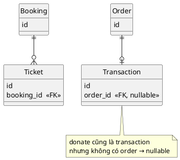

> Ghi chép từ buổi **Database Design** trong khoá **Ronin Engineer S02**. Ngữ cảnh MySQL. Tôn
> trọng tác giả: nội dung thuộc về giảng viên, đây chỉ là bản ghi chép lại để ôn.

## 1. Quy trình thiết kế

Không có quy trình chung cho mọi trường hợp. Đây là quy trình giảng viên dùng.

| Bước | Nội dung |
|---|---|
| **1. Phân tích yêu cầu** | Nắm bài toán business, cần lưu thông tin gì. Phân tích **data access pattern**: query lấy một record random hay query range theo ngày? Tổ chức dữ liệu phải phục vụ pattern đó. DB đã có sẵn thì phân tích **schema và convention hiện tại** để follow hoặc sửa |
| **2. List các trường** | Liệt kê mọi thông tin cần lưu |
| **3. Data modeling** | Xác định **các bảng**, **assign trường** vào bảng, chọn **primary key** và **foreign key**, xác định **quan hệ** giữa các bảng |
| **4. Tinh chỉnh** | Chỉnh lại cấu trúc từng bảng theo table format ở mục 2 |
| **5. Review integrity** | Dữ liệu có **duplicate** không? Cần **normalization** hay **denormalization**? |

Thứ tự khi thiết kế thật: xác định **quan hệ giữa các bảng trước**, rồi mới đi vào chi tiết từng bảng.

## 2. Table format chuẩn

### Vấn đề: thêm cột khoá toàn bảng

MySQL version cũ, `ALTER TABLE ADD COLUMN` cần **full table lock** → downtime, bảng không nhận
đọc ghi. Thiết kế bảng thế nào để hạn chế?

**Cách 1: cột `extra_data` kiểu JSON.** Cần thêm thông tin thì nhét vào JSON, không cần thêm cột.
Giải quyết được nhiều bài toán thực tế. Hạn chế: MySQL **không đánh index được trên field bên
trong JSON** → filter theo field JSON rất khó.

**Cách 2: tạo sẵn cột thừa.** Lúc tạo bảng tạo trước `c1`, `c2`… chưa dùng; sau cần thì đẩy dữ
liệu vào và **index được**. Nhược: phải có **tài liệu** ghi c1 lưu gì, c2 lưu gì, nên schema phức
tạp; **data type** không đúng ý. Đây là cách truyền thống của **ngân hàng**, vì downtime với hệ
thống tài chính rất nhạy cảm. Bao nhiêu cột thừa là đủ thì tuỳ **tốc độ phát triển business**,
không có con số cụ thể.

### Phân loại dữ liệu theo mục đích

| Loại | Ví dụ | Ghi chú |
|---|---|---|
| **Business data** | id, status, name, amount | **Quan trọng hơn**, mỗi business một khác. Xác định **trước** |
| **Technical data** | version, created_at, updated_at, created_by | Để tracking, debug, sort. Giống nhau giữa các business nên **reuse được**. Xác định **sau** |

Người mới hay sa đà vào bài toán technical chưa gặp mà bỏ quên phần quan trọng là business.

### Format gợi ý

```
id, status                                          -- bắt buộc với mọi entity
phone, email, username                              -- nhóm business 1: người book
ticket_count, original_amount, discount_amount, final_amount   -- nhóm business 2: booking
extra_data JSON                                     -- mở rộng không cần ALTER TABLE
version, created_at, created_by, updated_at, updated_by        -- technical
```

- **Entity là cái có ID và life cycle.** `status` đặc biệt quan trọng với phần mềm nghiệp vụ:
  phải vẽ được life cycle của nó.
- **Nhóm các cột business cùng quan hệ** đặt cạnh nhau.
- Thiết kế đủ format **ngay từ đầu**, kể cả cột chưa dùng đến. Đó là tư tưởng design: dễ mở rộng,
  tránh khi cần mới tạo.
- `version` dùng cho optimistic lock, thuộc bài transaction.

### Vấn đề: thêm index khoá toàn bảng

MySQL trước 5.6, add index khoá toàn bảng. Nâng version DB thì không đơn giản vì phải backward
compatible. Hai cách:

- **`pt-online-schema-change`** của Percona: tạo **bảng mới cùng cấu trúc cộng index mới**,
  **copy dần** dữ liệu từ bảng gốc, khi đồng bộ thì **rename** thay bảng cũ.
- Version mới có **online index**, đánh trực tiếp trên bảng, chỉ khoá vài record tại một thời
  điểm. Xem thêm ở trang [Index](/documents/database/indexing).

## 3. Phân loại bảng

| Loại | Nội dung |
|---|---|
| **Entity table** | Bảng chính chứa entity |
| **Relation table** | Bảng trung gian, thường cho quan hệ **n-n** |
| **Config table** | Danh sách country, cấu hình business (một booking tối đa bao nhiêu ticket) |
| **Support table** | **Tách một phần dữ liệu của bảng gốc** ra bảng khác để hỗ trợ entity. Tên do giảng viên tự đặt, không phải thuật ngữ official |

Phân nhóm để **nắm bức tranh tổng quan của schema**: bảng nào mục đích gì, và khi phát sinh yêu
cầu business mới thì biết **đặt thông tin mới ở đâu**.

## 4. Quan hệ giữa các bảng

| Quan hệ | Ví dụ |
|---|---|
| **1-1** | Student và card: một sinh viên một thẻ |
| **1-n** | Teacher và class: một teacher dạy nhiều class, một class một teacher |
| **n-n** | Student và class: cần **bảng trung gian** |
| Không quan hệ | Bảng notification độc lập |

## 5. Foreign key

### Quan điểm: không đặt ràng buộc ở database

Foreign key là ràng buộc: insert hoặc update phải check dữ liệu tham chiếu có tồn tại. Vấn đề:

1. **Schema phức tạp.**
2. Application nhận **exception chung** từ DB, muốn biết lỗi cụ thể là gì thì phải kiểm tra loại
   exception.
3. DB tốn thêm một phần workload để check.

Quan điểm của giảng viên: **implement ràng buộc ở application**, không đặt ở database. Đây là
quan điểm, có người làm cả hai.

- Application vốn đã phải **check trước** (user tồn tại chưa, còn active không, có được đăng ký
  không) nên biết **chính xác lỗi gì**.
- Implement được **ràng buộc phức tạp**, schema đơn giản.
- Thừa nhận ràng buộc ở DB cho tính đúng đắn cao hơn, nhưng logic chặt chẽ ở application thì
  **rất ít khi** dữ liệu mất tính đúng đắn.

Hai câu hỏi thường gặp. **SQL injection** không liên quan, chống bằng validate và encode input
trước khi chạm DB. **Dev fake data rồi xoá sót gây lỗi** là lỗi con người, đặt foreign key cũng
chỉ hạn chế chứ không tránh được.

### Đặt foreign key ở đâu

> **Cái sinh ra trước là gốc. Cái phát sinh sau lưu tham chiếu lên gốc.** Gốc không tham chiếu
> xuống cái sinh sau.



**Tại sao?** Nếu gốc tham chiếu xuống con thì mỗi khi thêm một luồng phát sinh mới lại phải
**thêm một cột tham chiếu vào bảng gốc** → thiết kế không mở rộng được. Con tham chiếu lên gốc
thì thêm luồng mới chỉ cần trỏ về gốc.

Với order và transaction: transaction giữ `order_id` kể cả khi có trường hợp không có order
(donate), cột đó **nullable**. Đặt foreign key phụ thuộc **luồng xử lý nghiệp vụ**.

## 6. Normalization và Denormalization

Bảng student lưu luôn tên lớp → hai record cùng "Math" là **duplicate**. Đổi tên lớp thành
"Advanced Maths" phải update mọi record, lỗi vài record là mất tính đúng đắn. Tách thành student,
class, enroll thì chỉ còn một record "Math".

**Normalization** là break bảng to thành các bảng nhỏ hơn để giảm dữ liệu dư thừa và tăng tính
đúng đắn.

**Denormalization** là lưu dữ liệu **thừa**, suy ra được từ dữ liệu gốc. Thừa khác duplicate.
Ví dụ đếm mỗi student học bao nhiêu lớp: vào bảng enroll đếm từng student, thậm chí scan cả bảng,
có index vẫn phải đếm. Thêm cột `class_count` trong student, học lớp mới thì tăng.

| | Ưu | Nhược |
|---|---|---|
| **Normalization** | Tăng tính đúng đắn, nhất quán | Một bảng thành ba, schema phức tạp, phải **JOIN**; tách quá thì query không hiệu quả |
| **Denormalization** | Query hiệu quả, tận dụng index, **tính toán trước** | Tốn không gian; **inconsistency** nếu cập nhật cột thừa bị lỗi |

**Thực tế kết hợp cả hai**, không chọn một. Không ít trường hợp cần denormalization vì nhiều yêu
cầu liên quan đến tính toán.

## 7. Data type

| Loại | Khuyến nghị |
|---|---|
| **VARCHAR** | Dữ liệu **ngắn, truy xuất nhanh, ít cập nhật** (username) |
| **TEXT** | Dài hơn 255, **cập nhật thường xuyên** (nội dung bài viết) |
| **Số nguyên** | Chọn kiểu **càng nhỏ càng tốt**: status vài chục giá trị thì `SMALLINT`, không cần `INT`. Hiểu nhầm phổ biến: `INT(1)` và `INT(9)` **cấp phát bộ nhớ như nhau**, số trong ngoặc chỉ là ràng buộc về số ký tự hiển thị |
| **FLOAT / DOUBLE** | Tốn ít chỗ hơn DECIMAL nhưng lưu **base 2** nên làm tròn về giá trị gần nhất biểu diễn được → **không dùng cho tiền** |
| **DECIMAL** | Khai báo được độ chính xác phần thập phân → dùng cho tiền và tài chính |
| **TIMESTAMP** | Thời gian **ít thay đổi** (created_at). Giới hạn khoảng giá trị ở hệ 32-bit |
| **DATETIME** | Không giới hạn khoảng, dễ đọc hơn, cho thời gian **hay thay đổi** (giờ họp). Hầu hết trường hợp dùng được |

Nguyên tắc chung: **nhỏ, đơn giản, hạn chế NULL**. Database xử lý NULL không tốt, logic NULL
trong SQL khác Java khác JavaScript, và DB không tối ưu query liên quan NULL.

## 8. Bốn case study

### Hỗ trợ đa ngôn ngữ

Bài post gốc tiếng Anh, dịch ra nhiều ngôn ngữ. Yêu cầu: thêm ngôn ngữ mới **không phá schema**,
dễ query.

Có nhiều giải pháp, kể cả tạo bảng translation riêng. Cách phổ biến cho bài toán này: giữ **cột
ngôn ngữ gốc** để truy xuất nhanh, cộng thêm cột **`translation` kiểu JSON** với **key là mã
ngôn ngữ, value là bản dịch**. Thêm ngôn ngữ mới chỉ là thêm một key vào object. Lấy bản dịch
chỉ cần đọc object rồi trích value.

### Thay đổi thứ tự một list

Todo list có cột `order` giá trị 1, 2, 3, 4. Đưa D lên đầu thì A, B, C đều phải update; list
1.000 phần tử là update toàn bộ. Dùng **linked list** (`next_task_id`) thì update đơn giản nhưng
lấy list phải đệ quy, khó query.

**Giải pháp: order có khoảng cách.** Đánh 1000, 2000, 3000, 4000. Chèn vào giữa 1 và 2 thì lấy
trung bình `(1000 + 2000) / 2 = 1500`, chỉ **update một record**; lấy list chỉ cần `ORDER BY`.
Đưa lên đầu thì `(0 + 1000) / 2 = 500`.

Hạn chế: dùng số nguyên, reorder nhiều lần đến khi hai số **liên tiếp** (1000, 1001) thì hết chỗ
chèn. Lúc đó dùng **float**.

### Tagging

Post có nhiều tag. Query 1 (phổ biến hơn): xem post thì lấy tất cả tag của post. Query 2: lấy
tất cả post có một tag.

- Bảng **n-n** post_tag cộng bảng tag: giải pháp ổn, chỉ thêm một thao tác vào bảng quan hệ, có
  index thì không tốn.
- Gợi ý thêm: cột **`tags` kiểu array** trong post. Query 1 lấy post ra là có tag luôn. Query 2
  dùng **inverted index**, PostgreSQL hỗ trợ **GIN** trên array.

Không phù hợp mọi trường hợp, đưa ra để tham khảo.

### Thống kê: đếm click hôm qua

Yêu cầu: **response time ưu tiên hơn độ chính xác**. Giải pháp từ đơn giản đến phức tạp:

1. **Xấp xỉ bằng statistics của DB.** `COUNT(*)` trên bảng bookings 2 triệu record mất ~29 giây;
   `EXPLAIN` trả **estimated rows** ~1,1 triệu, gần đúng và gần như tức thì.
2. **Thuật toán xác suất**: **HyperLogLog** ước tính cardinality.
3. **Tính toán trước** bằng cron job, hoặc **materialized view** nếu DB hỗ trợ (MySQL chưa có).
4. **Stream processing**: mỗi click là một event, xử lý luồng event ra tổng.

## 9. Tổng kết

1. **Tận dụng JSON** khi có thể, đơn giản mà hiệu quả cho nhiều bài toán thực tế.
2. Thực tế **kết hợp normalization và denormalization** để vừa đúng đắn vừa truy xuất hiệu quả.
3. Nhớ **table format**: id, status, business fields nhóm lại, extra_data JSON, version,
   created và updated.

## Thử làm

Thiết kế schema cho **hệ thống đặt ghế máy bay**, dùng table format ở mục 2.
