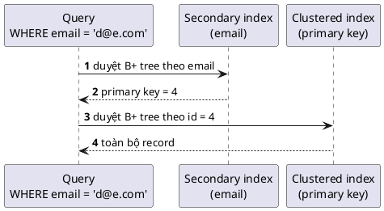

> Ghi chép từ hai buổi **Index** trong khoá **Ronin Engineer S02**. Lý thuyết giảng trên ngữ cảnh
> MySQL / InnoDB; phần thực hành chạy trên PostgreSQL với dataset airline (bảng `tickets` ~3M,
> `bookings` ~2M, `seats`). Tôn trọng tác giả: nội dung thuộc về giảng viên, đây chỉ là bản ghi
> chép lại để ôn.

## 1. Index là gì

Index là một **cấu trúc dữ liệu** để tối ưu tốc độ **truy xuất** dữ liệu. Giống mục lục sách:
không có mục lục thì lật từng trang, có mục lục thì mở thẳng đến chương cần tìm.

Hai điểm hay bị hiểu sai:

- Dữ liệu index **lưu trên ổ đĩa**, không phải RAM. Có thể được load lên RAM nhưng chỉ một phần.
- **Key khác index.** Key thể hiện **ràng buộc** (primary key = not null + unique; foreign key =
  giá trị phải nằm trong cột được tham chiếu). Index **không có ràng buộc nào**, chỉ để tìm nhanh.

## 2. Bốn cách phân loại

| Theo | Loại |
|---|---|
| Cấu trúc dữ liệu | B+ tree, hash, inverted index (full-text), spatial, bitmap, LSM tree, GiST |
| Tổ chức vật lý trên đĩa | **Clustered** / **Non-clustered** (secondary) |
| Số cột | Một cột / **composite** (nhiều cột) |
| Tính chất | Primary, unique, prefix |

Khi đánh giá một cấu trúc dữ liệu hay giải thuật, xét **theo thứ tự**: use case → time
complexity → space complexity → độ phức tạp triển khai. Không có cấu trúc nào cho mọi use case.

## 3. Phân loại theo cấu trúc dữ liệu

### B-tree

- Tất cả node lá **cùng level**.
- Mỗi node chứa **nhiều key**, các key đã **sắp xếp**. Node có k con thì chứa tối đa k−1 key.
- Search / insert / delete đều **O(log n)**.

### B+ tree

Biến thể của B-tree với hai điểm thêm:

1. **Pointer nối các node lá** với nhau như linked list. Range query tìm key đầu mút mất
   O(log n), sau đó **scan theo chiều đã sort** qua pointer, không phải quay lên trên tìm lại.
2. Node trung gian chứa nhiều key → **cây thấp** → **ít lần đọc đĩa**. Các key cùng một node nằm
   trong cùng block, node chỉ lưu pointer sang node khác.

Ví dụ truy vấn `>= 30 AND <= 90`: lần đọc đĩa 1 vào root, so 30 với các key ở root để chọn nhánh;
lần đọc 2 xuống node con, tìm đến 30 rồi đi theo pointer qua các node lá cho đến 90.

Với bảng ít phần tử thì không thấy khác biệt, nhưng bảng lớn thì số thao tác tăng lên rất nhiều.
Đó là lý do cần cấu trúc dữ liệu để tìm nhanh.

Điểm mấu chốt cần nhớ về B+ tree, không cần đi sâu cách insert hay cân bằng lại cây:

- Dữ liệu ở **node lá**, key ở node lá **đã sort**.
- Có **pointer** giữa node lá để range query nhanh.
- Search / insert / update đều **O(log n)**.
- Key là **giá trị của cột được đánh index**.

### Hash index

- Dùng hash function map một giá trị đầu vào → một giá trị hash, tương ứng **địa chỉ** nơi data nằm.
- Phù hợp so sánh **bằng** (`=`), tìm mất **O(1)**.
- **Không phù hợp** range query và sorting.
- Hạn chế **collision**: hai đầu vào khác nhau cho cùng giá trị hash. Hash function tốt là hash
  function có tỷ lệ collision thấp. Cách xử lý collision giống `HashMap` trong Java (linked list
  hoặc tree ở bucket), rất hay bị hỏi phỏng vấn.

### So sánh

| | B+ tree | Hash |
|---|---|---|
| Search / insert / delete | O(log n) | O(1) cho `=` |
| Range query, sorting | **Tốt** | **Không dùng được** |
| Hạn chế | — | Collision |

Số đo thật trên bảng `tickets` ~3M record, query `ticket_no = X`:

| | Plan | Thời gian |
|---|---|---|
| Không index | Parallel Seq Scan, 2 worker | ~324 ms |
| B-tree | Index Scan | 0.9 ms |
| Hash | Bitmap Index Scan | **0.2 ms** |

Đổi sang range `ticket_no >= X`: B-tree vẫn Index Scan **1.4 ms**; hash rớt về Seq Scan **3.6 ms**.

### Các cấu trúc khác

Full-text search dùng **inverted index**. Tìm theo địa lý dùng **spatial index**. **Bitmap
index** đáng tìm hiểu thêm. Trong một composite index **không thể** dùng cấu trúc khác nhau cho
từng cột.

## 4. Clustered và secondary index

### Clustered index

Là index xác định **dữ liệu bảng được sắp trên đĩa như thế nào**. Ghi dữ liệu xuống đĩa phải có
logic, không thể ghi ngẫu nhiên vào các block. Clustered index chính là logic xác định ghi ở đâu
và tiếp tục ghi ở đâu.

- Với B+ tree: key là primary key, **node lá chứa toàn bộ record** (mọi cột).
- Mỗi bảng **chỉ có một** clustered index, vì dữ liệu chỉ tổ chức được theo một logic.
- **Mặc định là primary key.** Về lý thuyết có thể đánh trên cột khác nhưng **không khuyến khích**.
- Bảng không có primary key → DB tạo một **cột ẩn** và đánh clustered index trên đó.

### Secondary index (non-clustered)

Muốn tìm theo cột khác (ví dụ `email`) thì tạo secondary index → DB xây thêm một B+ tree.
**Node lá của secondary index chỉ lưu primary key**, không lưu data. Một bảng có thể có nhiều
secondary index.



Đọc qua secondary index tốn **tối thiểu 2 lần đọc đĩa**: duyệt secondary lấy primary key, rồi
duyệt clustered lấy record. Có thể nhiều hơn 2: với composite index phải duyệt hết cây cột thứ
nhất rồi nhảy sang cây con cột thứ hai, và cây to thì không load hết một lần từ đĩa lên được.

### Tại sao node lá lưu primary key mà không lưu pointer địa chỉ đĩa?

Địa chỉ đĩa **có thể thay đổi**: ổ đĩa phân mảnh rồi defragment, dữ liệu xê dịch. Nếu mọi
secondary index lưu pointer thì mỗi lần dữ liệu dịch chuyển, **tất cả secondary index phải cập
nhật**. Lưu primary key thì chỉ clustered index cần thay đổi. Primary key **không đổi**.

## 5. Phân loại theo tính chất

**Primary index.** Khai báo primary key → DB tự tạo, unique cho từng row. Nên để primary key là
số **auto-increment**: record mới thêm vào cuối, ghi **cạnh nhau trong một block** → ít phân
mảnh, tiết kiệm không gian, truy xuất tốt hơn. Trừ khi business hoặc security yêu cầu format khác.

**Unique index.** Khác primary ở chỗ **cho phép null** nhưng **không cho trùng**.

```sql
CREATE UNIQUE INDEX idx_users_email ON users(email);
```

**Prefix index.** Cột VARCHAR rất dài thì chỉ đánh index trên **N ký tự đầu** để giảm size.

## 6. Composite index

Composite index là index trên **nhiều cột**. Cũng là secondary index, node lá chứa primary key.
Càng nhiều cột càng tốn không gian.

### Cấu trúc: cây xây theo thứ tự cột

Với index `(name, country)`: xây cây trên `name` trước, **mỗi node** của cây name lại có một
**cây con** trên `country`. Hai người tên Patrick, một ở UK một ở Việt Nam → node "Patrick" có
cây con country với 2 nhánh. Node lá chứa primary key → duyệt clustered index.

Hệ quả: query phải **đi từ cột đầu** thì mới vào được index.

### Bài tập: index `(country, province, name)`, query nào ăn index?

| WHERE | Ăn index? | Lý do |
|---|---|---|
| `province = … AND country = …` | **Có** | Với `AND`, thứ tự cột trong WHERE không có ý nghĩa. Optimizer vẫn đọc country → province |
| chỉ `province` | Không | Province là cây thứ 2, phải qua cây country mới vào được |
| `name AND province` | Không | Thiếu country |
| có `country = 'US'` | **Có** | Có cột đầu của index |

`SELECT *` không ảnh hưởng việc ăn index. WHERE là để **tìm ra record**, còn lấy bao nhiêu cột là
logic phía sau: sau khi lấy primary key từ secondary, vẫn duyệt clustered lấy toàn bộ cột.

### Thứ tự cột

Trước hết theo **data access pattern**: query hay lọc theo gì thì cột đó lên đầu. Nếu pattern như
nhau thì **cột high cardinality lên đầu**.

**Cardinality** = số giá trị khác nhau của cột. Cột nhiều giá trị → cây **nhiều nhánh** → mỗi
node **ít key** → duyệt nhanh. Ngược lại cột như giới tính chỉ có 2 nhánh, nhánh "nam" chứa toàn
bộ người nam và phải duyệt hết.

| Cột | Cardinality ước lượng |
|---|---|
| country | ~200 |
| province | ~20.000 |
| name | ~1.000.000 |

→ Thứ tự hiệu quả hơn: `(name, province, country)`.

Số đo thật trên `bookings` ~2M, query `book_date` trong một ngày AND `total_amount > X`, cả hai
trả về ~2.000 record:

| Distinct | book_date **~540.000** | total_amount ~5.600 |
|---|---|---|
| Index | `(book_date, total_amount)` | `(total_amount, book_date)` |
| Thời gian | **25 ms** | 168 ms |

Cột high cardinality lên đầu nhanh **~7 lần**. Đừng để chữ "date" đánh lừa: `book_date` là
timestamp, khác nhau đến giây, nên dù query trong một ngày thì trong ngày đó vẫn rất nhiều giá trị.
Cardinality tính theo **giá trị thật đo trên dữ liệu**, không theo tên cột.

### Một composite index cho nhiều query: pushdown

`booking0` đang có `(book_date, total_amount)`. Thêm query 2 chạy thường xuyên: booking trong
ngày, không lọc total_amount, `ORDER BY book_ref`.

| Cách | Plan | Thời gian |
|---|---|---|
| Thêm composite `(book_date, book_ref)`, bảng có 2 index | Chỉ dùng index cũ, heap scan 54K rows rồi Sort | 94 ms |
| **Một composite `(book_date, total_amount, book_ref)`** | Index Only Scan | **14 ms** |

Theo logic "đi từ cột đầu", query chỉ có `book_date` và `book_ref` không đi được qua cột giữa.
Nhưng PostgreSQL có **pushdown**: đi vào `book_date`, **bỏ qua** `total_amount`, dùng tiếp
`book_ref`. Thêm `WHERE book_ref >= X` vẫn ăn index.

Bài học:

- Các query có **điểm vào chung** (ở đây là `book_date`), chỉ khác điều kiện tiếp theo → **một
  composite index** là đủ. Không đánh index "cò mổ" từng cột.
- Điều kiện là phải có đầu vào chung. Query 1 lọc `(A, B)`, query 2 lọc `(C, D)` không giao
  nhau → composite `(A, B, C, D)` **không phù hợp**, phải tách.

### Covering index

Composite index **chứa đủ các cột trong SELECT**. Khi duyệt index, node lá đã có giá trị các cột
→ trả về ngay, **không cần vào clustered index** → giảm I/O rõ rệt. Recommend **≤ 5 cột**.

Số đo trên bảng cấu hình `seats`, query `SELECT aircraft_code, seat_no, fare_conditions WHERE
aircraft_code = '733'`, trả về 130 ghế:

| Index | Plan | Thời gian |
|---|---|---|
| PK `(aircraft_code, seat_no)` | Index Scan | 0.7 ms |
| Covering `(aircraft_code, seat_no, fare_conditions)` | Index Only Scan | **0.2 ms** |
| `(aircraft_code, seat_no) INCLUDE (fare_conditions)` | Index Only Scan | 0.3 ms |

Đã nhanh sẵn nhưng query chạy rất nhiều lần khi booking, và bảng có thể lớn hơn, nên vẫn đáng.

**`INCLUDE`**: cột được **gắn vào index để trả về** nhưng **không tham gia build cây**. Dùng khi
không có query nào lọc trên cột đó → update index rẻ hơn. Tốc độ không bằng covering thường
nhưng vẫn ổn.

### Composite index làm primary key

Bình thường, dùng nhiều. Điển hình là bảng quan hệ **nhiều-nhiều**: bảng trung gian
`(student_id, class_id)` đánh primary key trên cả 2 cột.

## 7. Nhược điểm của index

| Nhược điểm | Chi tiết |
|---|---|
| **Chậm thao tác ghi** | Mỗi lần ghi vào B+ tree mất O(log n) và phải cập nhật cây trên đĩa. Bảng nhiều index → insert chậm |
| **Tốn không gian** | Bảng càng lớn index càng lớn |
| **Tạo index mất thời gian** | Bảng đã nhiều dữ liệu thì build cây không xong ngay. DB cũ có thể **lock bảng**; DB mới có **online index**. Tạo index trên 3M record local mất ~6 giây, production không chấp nhận downtime đó |
| **Phải maintain** | Theo thời gian cây **imbalance**, phải duyệt nhiều hơn → chậm đi. Việc review nên để DBA làm |

**Bao nhiêu index là nhiều?** Phụ thuộc DB và dữ liệu, phải monitor. Kinh nghiệm: **7–10
index/bảng** vẫn chưa làm chậm ghi, **trên 10 cần cân nhắc**.

Lưu ý: `UPDATE ... WHERE col = x` với `col` có index vẫn **nhanh hơn** không index. Update gồm
**tìm** rồi **ghi**, và phần tìm tốn hơn.

## 8. Khi nào nên và không nên dùng index

| Nên | Không nên |
|---|---|
| Query thường dùng có `WHERE / JOIN / GROUP BY / ORDER BY` | Cột **cardinality thấp** (giới tính) |
| Tìm **tập nhỏ** record (vài trăm trong 10M) | Bảng **quá ít dữ liệu** (dưới ~1.000 record) |
| Cột cần **unique** | Tìm **tập rất lớn** (2–5M trong 10M): optimizer có thể bỏ index |

Số đo trên `bookings` ~2M, index trên `book_date`:

| Query | Plan | Ghi chú |
|---|---|---|
| Một ngày | Bitmap Index Scan → Bitmap Heap Scan, 92 ms | Ăn index |
| Cả năm 2017 (~1,2M rows) | **Seq Scan** | Optimizer bỏ index vì tập quá lớn, seq scan còn nhanh hơn |

Ngưỡng tham khảo theo số record trả về:

| Số record | Index |
|---|---|
| Vài nghìn | Phù hợp |
| Vài chục nghìn → vài trăm nghìn | Phải kiểm tra còn ăn index không |
| Hàng triệu | Optimizer bỏ index |

## 9. Các trường hợp index không ăn

Ngữ cảnh MySQL, PostgreSQL tương tự. Nên tự verify bằng `EXPLAIN ANALYZE`.

| Trường hợp | Ví dụ | Lý do |
|---|---|---|
| `LIKE` với `%` ở đầu | `name LIKE '%abc'` | Index build theo ký tự trái → phải (R → RO → ROI). `%` đầu khớp bất kỳ ký tự → phải duyệt hết. `LIKE 'R%'` thì ăn |
| `OR` với cột không index | `id = 1 OR age = 18` | `age` không có index → optimizer thấy vẫn phải full scan, mà full scan thì check được cả 2 điều kiện một lượt → bỏ index luôn. `AND` thì ok |
| Sai kiểu dữ liệu | `id VARCHAR`, query `id = 10` | MySQL convert **chữ → số** (số so sánh dễ hơn). `id INT` với `'10'` convert vế phải một lần → ăn. `id VARCHAR` với `10` phải convert **từng dòng** → không ăn, có thể lỗi |
| Function trên cột | `LEN(name) = 6` | Index build trên giá trị cột, không phải giá trị function. Oracle/Postgres/MySQL mới có function-based index nhưng **không khuyến khích**, phải test. MySQL cũ chưa có |
| Expression trên cột | `id + 1 = 10` | Optimizer MySQL không tốt với expression: không chọn được index, cũng không rewrite query |

## 10. Best practices

1. **Hạn chế số index** trên một bảng.
2. **Primary key auto-increment**, trừ khi business hoặc security yêu cầu khác.
3. **Tránh NULL** ở cột index: optimizer bị confused. Cho default value.
4. **Covering index** để giảm I/O.
5. **Prefix index** cho VARCHAR dài.
6. **Tận dụng composite index** cộng pushdown, hạn chế đánh lẻ tẻ từng cột.
7. Tránh các trường hợp ở mục 9. **Monitor** và review index định kỳ.
8. **Cẩn thận ORM** (Hibernate/JPA, các ORM trên Node.js): phải xem query gen ra trông thế nào và
   có ăn index không, không dựa dẫm.
9. **Kiểm soát mọi query trước khi lên production**, kể cả query ít chạy nhưng workload lớn. Để
   đến lúc dữ liệu lớn mới sửa là muộn và tốn.

## 11. Một câu SQL đi qua MySQL thế nào

Đây là kiến trúc **MySQL**, không phải RDBMS nói chung. Server chia **2 layer**: server layer và
storage engine.

```
Client (driver) → Connector → [Query cache, bỏ từ 8.0] → Parser → Optimizer → Executor
→ Storage engine (access method → buffer pool → file; ghi thì qua transaction manager + lock manager)
```

| Bước | Làm gì |
|---|---|
| Connector | Tiếp nhận câu SQL từ driver phía client |
| Query cache | Chỉ MySQL trước 8.0. Bị bỏ vì bảng cập nhật thường xuyên thì cache toàn bộ kết quả không hiệu quả. **Query cache ≠ buffer pool**, buffer pool vẫn còn ở storage engine |
| Parser | Bóc tách keyword, check cú pháp (`FORM` → lỗi ngay), xây **syntax tree** |
| Optimizer | Preprocessor check bảng tồn tại, mở rộng `*`. Rồi từ **syntax tree + statistics của bảng + thông tin index** tính ra các **execution plan**, chọn plan **cost thấp nhất** theo DB *cho rằng* |
| Executor | Dùng plan gọi xuống storage engine |
| Storage engine | Access method xác định đọc hay ghi. **Đọc**: buffer pool trước, không có thì đọc file. **Ghi**: qua transaction manager và lock manager |

Mỗi storage engine có đặc tính khác nhau: read heavy → **InnoDB**; write heavy ghi nối tiếp
(log) → cân nhắc engine khác.

**Thứ tự thực thi mệnh đề** (đúng hầu hết, JOIN là phần chưa chuẩn nhất):

```
FROM / JOIN → ON → WHERE → GROUP BY → HAVING → SELECT → ORDER BY → LIMIT
```

## 12. Execution plan trên PostgreSQL

Execution plan mô tả **chi tiết từng bước** DB lấy dữ liệu. Query chỉ nói "muốn gì", plan cho
biết DB **làm thế nào**: có ăn index không, ăn **đúng index mình muốn** chưa. Dùng PostgreSQL vì
plan chi tiết và dễ đọc hơn MySQL.

```sql
EXPLAIN SELECT ...;                              -- chỉ tính plan, không chạy
EXPLAIN ANALYZE SELECT ...;                      -- chạy thật, có số thực tế: luôn dùng cái này
EXPLAIN (ANALYZE, BUFFERS) SELECT ...;           -- thêm số block đọc từ buffer
EXPLAIN (ANALYZE, FORMAT YAML) SELECT ...;       -- hoặc JSON, dễ đọc khi plan dài
```

Chỉ show được plan **đã chọn**. Các plan khác bị xoá ngay sau khi optimizer chọn xong.

### Các loại scan

| Loại | Cách hoạt động |
|---|---|
| **Seq Scan** | Đọc **từng bản ghi**, gửi lên executor check điều kiện. Rất chậm với bảng lớn |
| **Parallel Seq Scan** | Nhiều worker thread scan song song, node ngoài **Gather** gom kết quả |
| **Index Scan** | Duyệt B-tree từ root xuống node lá |
| **Index Only Scan** | SELECT chỉ lấy cột **đã nằm trong index** → không chọc vào heap |
| **Bitmap Index Scan + Bitmap Heap Scan** | Dùng index sinh **bitmap** các vị trí có khả năng chứa row, rồi đọc heap theo bitmap. Có thể **kết hợp nhiều index** thành một bitmap |

### Các trường

| Trường | Ý nghĩa |
|---|---|
| Node Type | Loại thao tác: scan, Join, Sort, Limit… |
| Index Name / Index Cond | Index được dùng và điều kiện áp lên index |
| Startup Cost *(ước tính)* | Chi phí đến khi lấy được **record đầu tiên** thoả điều kiện |
| Total Cost *(ước tính)* | Chi phí toàn bộ |
| Plan Rows / Plan Width *(ước tính)* | Số record dự kiến, size trung bình một record (byte) |
| Actual Startup Time / Actual Total Time | Thời gian thật (ms), chỉ có với `ANALYZE` |
| Actual Rows | Số record thật |
| Shared Hit Blocks | Số block đọc từ buffer, chỉ có với `BUFFERS` |

### Cách đọc

- Plan **lồng nhau**, đọc và thực thi **từ trong ra ngoài**. Đọc thời gian ở **node ngoài cùng**.
- **Estimate chỉ để tham khảo**, thường lệch xa thực tế. Ví dụ bảng `tickets` không index: Plan
  Rows ước tính nhiều, thực tế 1; cost ước tính 318, thực tế 324 ms. → Luôn chạy `ANALYZE`.
- **Startup cost** dùng để check query có chạy như hình dung không: ăn index mà startup cost rất
  lâu → có vấn đề khi tìm record đầu tiên. Seq scan có startup cost gần 0 vì lấy ngay bản ghi đầu
  dù chưa thoả điều kiện. Thực tế ít dùng.
- Khi plan không như mong muốn thì phải xem tại sao, nhưng đó là kỹ thuật thiên về DBA.

## 13. Hai cách optimize query

| Cách | Làm gì | Ví dụ |
|---|---|---|
| **Trực tiếp** | Đổi chính câu query | Subquery → JOIN, tách query, đánh index |
| **Gián tiếp** | Đổi cách tổ chức dữ liệu hoặc data access pattern | Denormalize: lưu cột "số lớp đã đăng ký" thay vì count mỗi lần. Tách một query random access thành nhiều query tuần tự |

Thực tế dùng cả hai. Cách trực tiếp có giới hạn. Các bài "tối ưu 100 lần" trên mạng thường là
cách gián tiếp. Index là một cấu trúc dữ liệu giải quyết **một bài toán cụ thể**, không phải tất cả.

MySQL và PostgreSQL **rất khác nhau** cả kiến trúc lẫn cách xử lý query. Mỗi DB chỉ phù hợp một
số loại dữ liệu và access pattern, không có DB nào làm được tất cả.

## Thử làm

1. Cài dataset airline (bản 2.5GB, có bảng 2M–8M record) bằng Docker + PostgreSQL. Chọn ít nhất
   3 case ở mục 9, viết query, chạy `EXPLAIN ANALYZE`, chỉ ra ăn hay không ăn index và giải thích.
2. Chọn một query trong dự án của bạn, xem execution plan, đề xuất tối ưu và giải thích.
3. Đánh index cho schema booking flight bạn đã design.
4. Tìm hiểu `COUNT(*)` vs `COUNT(1)` vs `COUNT(pk)` khác nhau thế nào. Giảng viên ưu tiên `COUNT(*)`.
